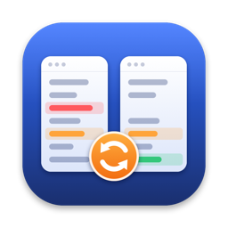
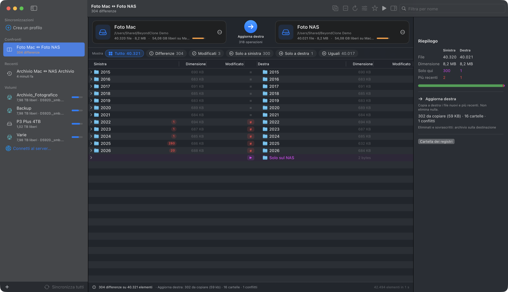

<p align="center">
  
</p>

<h1 align="center">BeyondClone</h1>

<p align="center">
  Confronto, sincronizzazione e mirror di cartelle per macOS, sul Mac e sul NAS.<br>
  App nativa in Swift e SwiftUI, compilabile senza Xcode.
</p>



## Cosa fa

BeyondClone mette due cartelle una accanto all'altra e mostra subito cosa è uguale, cosa è cambiato e cosa esiste da un solo lato. Da lì si copia a mano quello che serve, oppure si lancia una sincronizzazione completa in una delle cinque modalità. Le coppie usate spesso si salvano come profili e si possono eseguire anche tutte insieme, in parallelo.

È pensata per l'uso reale con un NAS (Synology e simili): l'analisi è progressiva e parallela, le condivisioni SMB si montano da sole, i file eliminati o sovrascritti finiscono in un archivio recuperabile sulla destinazione invece che spariti.

## Funzioni

**Confronto**

- Analisi progressiva: il primo livello compare subito e l'albero si riempie mentre fino a 12 cartelle vengono lette in contemporanea, cosa che sulle share di rete fa la differenza. Le cartelle che apri hanno la precedenza.
- Albero nativo (NSOutlineView) con i due lati affiancati, dimensioni delle cartelle, numero di differenze dentro ogni cartella, colori per modificati, più recenti e orfani. Regge decine di migliaia di elementi: 42.000 file per lato analizzati in circa un secondo su disco locale.
- Filtri con conteggio (Tutto, Differenze, Modificati, Solo a sinistra, Solo a destra, Uguali) e ricerca per nome.
- Criteri: dimensione e data (predefinito, veloce), solo dimensione, oppure contenuto byte per byte.
- Opzioni utili con il NAS: tolleranza sulle date, scarto di un'ora esatta ignorato (ora legale o fuso diverso), abbinamento dei nomi senza distinguere maiuscole e minuscole, file nascosti, esclusioni con modelli (`*.tmp`, `node_modules`, `@eaDir`, `#recycle` e simili sono già esclusi).
- Doppio clic su una coppia di file per confrontarne il contenuto: testo riga per riga e dentro la riga, esadecimale per i binari, immagini affiancate, in differenza o sovrapposte.

**Sincronizzazione**

- Cinque modalità: aggiorna destra, aggiorna sinistra, aggiorna entrambe (vince il più recente), specchia a destra, specchia a sinistra.
- Anteprima obbligatoria con totali per direzione, elenco di ogni operazione e avviso se sulla destinazione manca spazio.
- Copie in parallelo con avanzamento per byte, velocità, tempo stimato e interruzione anche a metà file (`copyfile(3)`).
- Ogni file viene copiato su un temporaneo e poi rinominato: un'interruzione non lascia file a metà. La data di modifica viene mantenuta, così il confronto successivo risulta allineato.
- Eliminati e sovrascritti: archivio sulla destinazione (`.beyondclone-archivio/data-ora/`, predefinito e funzionante anche sul NAS), Cestino del Mac, oppure eliminazione definitiva.
- Registro testuale di ogni esecuzione in `~/Library/Logs/BeyondClone`.

**Profili, recenti e NAS**

- Profili salvati con cartelle, modalità, criterio ed esclusioni; ogni profilo può indicare un server (`smb://DS920.local/Foto`) da montare in automatico se la cartella non è raggiungibile.
- "Sincronizza tutti" analizza tutti i profili e li esegue insieme dopo una conferma.
- Confronti recenti nella barra laterale e nella schermata iniziale; all'avvio si riapre l'ultimo confronto o profilo usato.
- Volumi montati con spazio libero, connessione a server SMB, AFP e NFS con credenziali dal Portachiavi.
- Ogni pulsante ha una descrizione al passaggio del mouse.

## Requisiti

- macOS 14 Sonoma o successivo, Apple Silicon o Intel.
- Command Line Tools di Apple (`xcode-select --install`). Xcode non serve.

## Compilare e avviare

```bash
./build.sh
open BeyondClone.app
```

`build.sh` compila in modalità release con SwiftPM e crea `BeyondClone.app` nella cartella del progetto. I file intermedi stanno in `~/Library/Caches/BeyondClone-build`, fuori dal Desktop: con la sincronizzazione iCloud della scrivania il database di build di SwiftPM dava errori di I/O.

Da riga di comando si può aprire direttamente un confronto:

```bash
open BeyondClone.app --args --left "/percorso/cartella A" --right "/Volumes/NAS/cartella B"
```

## Autotest

```bash
BeyondClone.app/Contents/MacOS/BeyondClone --selftest
```

Verifica il motore di confronto del testo (3.000 casi casuali contro la sottosequenza comune più lunga calcolata in modo esatto, più un file da 60.000 righe) e il motore delle cartelle su file veri: conteggi, mirror con archivio, aggiornamento in una e in due direzioni, date mantenute, nomi con maiuscole diverse, cartella non raggiungibile, avanzamento e interruzione della copia.

## Dove stanno i dati

| Cosa | Dove |
| --- | --- |
| Profili | `~/Library/Application Support/BeyondClone/profili.json` |
| Registri delle esecuzioni | `~/Library/Logs/BeyondClone/` |
| Recenti e ultima selezione | preferenze dell'app (`local.beyondclone.app`) |
| File eliminati o sovrascritti | `.beyondclone-archivio/` nella cartella di destinazione |

## Struttura del codice

| File | Contenuto |
| --- | --- |
| `DirModel.swift` | Albero confrontato, lettura parallela dei due lati, classificazione, opzioni |
| `Sync.swift` | Modalità, pianificatore delle operazioni, esecutore con `copyfile`, registro |
| `FolderSession.swift` | Sessione di confronto: analisi progressiva, filtri, piani, recenti |
| `DirOutline.swift` | Vista ad albero nativa e menu contestuale |
| `MainWindow.swift` | Finestra principale, barra laterale, benvenuto, connessione al server, "Sincronizza tutti" |
| `Workspace.swift` | Schede delle cartelle, filtri, barra di stato, ispettore, opzioni |
| `Sheets.swift` | Anteprima delle operazioni ed editor dei profili |
| `Profiles.swift` | Profili, montaggio NAS (NetFS), volumi (`getmntinfo`) |
| `DiffEngine.swift`, `TextCompare*.swift`, `HexCompare.swift`, `ImageCompare.swift` | Confronto del contenuto dei file |
| `SyncSelfTest.swift` | Autotest del motore cartelle |
| `Support/` | `Info.plist`, icona e lo script che la disegna (`make_icon.swift`) |

Per rigenerare l'icona: `swift Support/make_icon.swift Support/AppIcon-1024.png`, poi `iconutil` su un iconset ricavato con `sips`.

## Note

- Il NAS reale va ancora collaudato a fondo: permessi, attributi estesi e prestazioni su SMB sono stati gestiti nel codice (per esempio con ripiego sulla sola copia dei dati se la share rifiuta gli attributi), ma i test automatici girano su disco locale.
- "Ferma" durante una sincronizzazione interrompe anche il file in copia; quelli già copiati restano.
- Le descrizioni al passaggio del mouse usano un ritardo di mezzo secondo impostato dall'app, indipendente da `NSInitialToolTipDelay` globale.

## Come è nata

Il progetto è stato sviluppato in sessioni con Claude Code: l'idea, le priorità e le correzioni di rotta sono di Giuseppe Lupo, il codice è stato scritto dai modelli Claude Fable 5.2 e Claude Opus 5.5.
