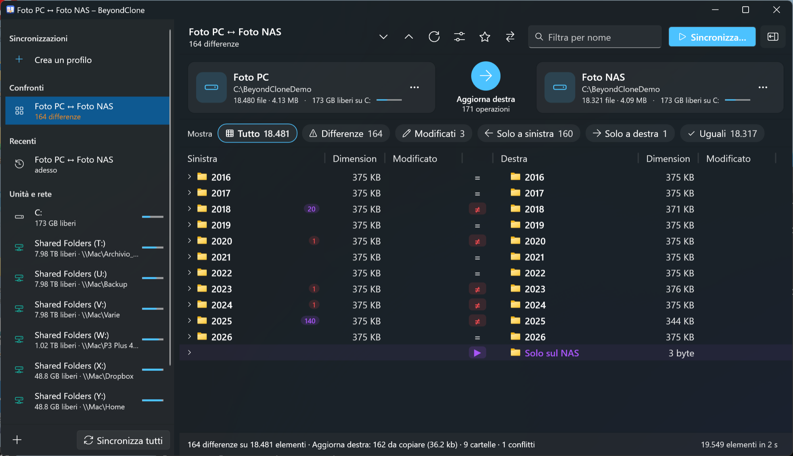

# BeyondClone per Windows

Versione per Windows 10 e 11 di BeyondClone: confronto, sincronizzazione e mirror di cartelle, sul PC e sul NAS. Stesse funzioni della versione per Mac, scritta in C# con .NET 10 e WPF nel tema Fluent di Windows 11, scuro per impostazione predefinita.



## Scaricare e avviare

Nella pagina [Releases](../../../releases) ci sono due eseguibili autonomi: non serve installare nulla, nemmeno .NET.

| File | Per |
| --- | --- |
| `BeyondClone-windows-x64.exe` | PC con processore Intel o AMD (la quasi totalità) |
| `BeyondClone-windows-arm64.exe` | PC con processore ARM (Snapdragon, Windows in Parallels su Mac Apple Silicon) |

Al primo avvio Windows SmartScreen può avvisare che l'app non è firmata: "Ulteriori informazioni", poi "Esegui comunque".

## Funzioni

**Confronto di cartelle**

- Analisi progressiva e parallela: il primo livello compare subito, fino a 12 cartelle vengono lette insieme (utile sulle condivisioni di rete), le cartelle che apri hanno la precedenza.
- Lista a colonne con i due lati affiancati, icone di Esplora file, dimensione delle cartelle, numero di differenze dentro ogni cartella, colori per modificati (rosso), più recenti, presenti da un solo lato (viola), file contro cartella (arancio).
- Filtri con conteggio: Tutto, Differenze, Modificati, Solo a sinistra, Solo a destra, Uguali. Ricerca per nome (Ctrl+F).
- Criteri: dimensione e data, solo dimensione, contenuto byte per byte. Tolleranza sulle date, scarto di un'ora esatta ignorato (ora legale, fuso del NAS), maiuscole e minuscole, file nascosti e di sistema, esclusioni con modelli (`Thumbs.db`, `desktop.ini`, `@eaDir`, `#recycle` e simili già esclusi).
- Doppio clic su una coppia di file per confrontarne il contenuto: testo riga per riga e dentro la riga (con copia tra i lati, modifica, annulla, salvataggio), esadecimale per i binari, immagini affiancate, in differenza o sovrapposte.

**Sincronizzazione**

- Cinque modalità: aggiorna destra, aggiorna sinistra, aggiorna entrambe, specchia a destra, specchia a sinistra.
- Anteprima obbligatoria con totali per direzione, elenco filtrabile delle operazioni, avviso se manca spazio sulla destinazione.
- Copie in parallelo con avanzamento per byte, velocità, tempo stimato e interruzione anche a metà file. Ogni file passa da un temporaneo e viene rinominato solo a copia finita; date e attributi vengono mantenuti.
- Eliminati e sovrascritti: archivio sulla destinazione (`.beyondclone-archivio\data-ora\`, predefinito, funziona anche sul NAS), Cestino di Windows (solo dischi locali; sulle condivisioni si ripiega sull'archivio), eliminazione definitiva.
- Registro di ogni esecuzione in `%LOCALAPPDATA%\BeyondClone\Registri`.

**Profili, recenti, rete**

- Profili salvati, con condivisione da collegare in automatico (`\\DS920\Foto`) se la cartella non è raggiungibile; le credenziali le chiede Windows e può memorizzarle.
- "Sincronizza tutti": analizza tutti i profili e li esegue in parallelo dopo una conferma.
- Confronti recenti nella barra laterale e nella schermata iniziale; all'avvio si riapre l'ultimo confronto o profilo.
- Unità locali, rimovibili e di rete con spazio libero; le unità che non rispondono non bloccano l'app.
- Percorsi lunghi oltre 260 caratteri abilitati.
- Aspetto scuro, chiaro o come Windows (Opzioni). Ogni pulsante ha una descrizione al passaggio del mouse.

## Riga di comando

```powershell
BeyondClone.exe --left "D:\Foto" --right "\\DS920\Foto"
BeyondClone.exe --files "relazione_v1.txt" "relazione_v2.txt"
```

## Compilare

Serve il .NET 10 SDK.

```powershell
.\build.ps1 -Test
```

Esegue gli autotest del motore e crea `dist\win-x64\BeyondClone.exe` e `dist\win-arm64\BeyondClone.exe`, autonomi e in un solo file.

## Struttura

| Progetto | Contenuto |
| --- | --- |
| `src/BeyondClone.Core` | Motore: albero confrontato e lettura dei due lati (`Model.cs`, `Lister.cs`), pianificatore ed esecutore delle copie, Cestino (`Sync.cs`), profili e impostazioni (`Profiles.cs`), condivisioni di rete e unità (`Net.cs`), diff del testo (`TextDiff.cs`) |
| `src/BeyondClone.SelfTest` | Autotest: diff contro la sottosequenza comune più lunga esatta, mirror con archivio, aggiornamenti, Cestino, maiuscole, date, copia con interruzione |
| `src/BeyondClone` | Interfaccia WPF: finestra principale (`MainWindow.xaml`), sessione con analisi progressiva (`Session.cs`), stato dell'app (`AppState.cs`), finestre di dialogo (`Dialogs.cs`), confronto del contenuto dei file (`FileCompare.cs`) |

## Dove stanno i dati

| Cosa | Dove |
| --- | --- |
| Profili | `%APPDATA%\BeyondClone\profili.json` |
| Recenti, ultima selezione, aspetto | `%APPDATA%\BeyondClone\impostazioni.json` |
| Registri | `%LOCALAPPDATA%\BeyondClone\Registri\` |
| File eliminati o sovrascritti | `.beyondclone-archivio\` nella cartella di destinazione |

## Note

- Provata su Windows 11 Pro ARM64 (in Parallels) con cartelle locali e unità condivise dal Mac. La build x64 è compilata ma non provata su un PC x64; un NAS Synology vero non è ancora stato provato.
- La copia trasferisce dati, date e attributi; non copia i flussi di dati alternativi (ADS) né i permessi NTFS.
